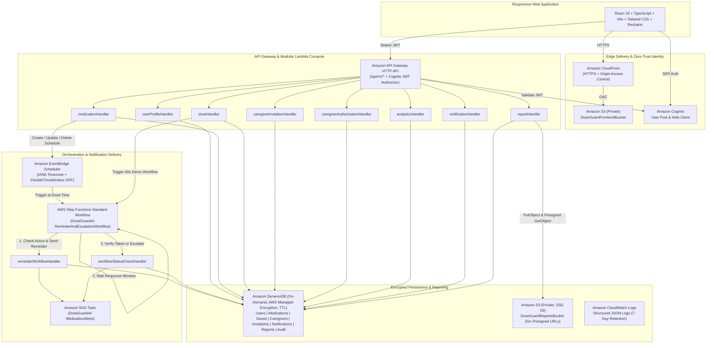

# DoseGuard AI
### Serverless Medication Safety & Caregiver Escalation Platform

> **"Never let a medication dose go unnoticed."**

DoseGuard AI is an end-to-end, production-grade AWS Serverless medication safety and caregiver escalation platform built with **AWS Lambda, Amazon API Gateway (HTTP API), Amazon DynamoDB, Amazon S3, AWS Step Functions, Amazon EventBridge Scheduler, Amazon Cognito, Amazon CloudFront, Amazon SNS, and AWS CDK v2 (TypeScript)**.

---

## 1. The Problem & The Solution

### The Problem
Elderly patients living independently frequently manage complex daily medication regimens. Traditional medication trackers focus on recording schedules or displaying local phone notifications. When a patient forgets or is unable to take a critical dose, family members and caregivers have no timely visibility that a dose was missed.

### The Solution
DoseGuard AI implements a **closed-loop serverless reminder, confirmation, and caregiver escalation workflow**:
1. **Medication Schedule Management**: Patients configure medications, dosage descriptions, start/end dates, and their IANA timezone (`Asia/Kolkata`, `America/New_York`, etc.), which automatically provisions a recurring schedule in **Amazon EventBridge Scheduler**.
2. **Patient Dose Confirmation**: Patients confirm scheduled doses with a single click (`TAKEN`, `PENDING`, `MISSED`) backed by idempotent composite DynamoDB keys.
3. **Stateful Step Functions Escalation Loop**: At the scheduled dose time, **AWS Step Functions** checks if the dose is already confirmed; if not, it sends an idempotent reminder, waits for a configurable response window (**15 minutes standard default** / **60 seconds demo mode**), re-checks DynamoDB, and—only if still unconfirmed—marks the dose as `MISSED` and alerts connected caregivers.
4. **Cryptographic Caregiver Access Control**: Patients generate single-use passcodes (`DG-XXXX-XXXX-XXXX-XXXX`) stored only as **SHA-256 hashes** in DynamoDB and redeemed atomically via conditional writes.
5. **Adherence Analytics & Private S3 Reports**: Real-time Recharts analytics (`Daily`, `Weekly`, `Monthly`) and downloadable CSV/JSON adherence reports stored in a private encrypted **Amazon S3** bucket accessed via short-lived **5-minute presigned URLs**.

> **Honest Scope & Non-Diagnostic Notice**: DoseGuard AI is an organizational scheduling, reminder, and caregiver escalation tool. It does not fabricate AI clinical predictions, medical diagnoses, or dosage recommendations, and does not claim HIPAA certification.

---

## 2. AWS Serverless Architecture



---

## 3. AWS Services & Responsibilities

| Service | Responsibility in DoseGuard AI |
| :--- | :--- |
| **AWS Lambda** | 10 single-responsibility TypeScript functions (`userProfileHandler`, `medicationHandler`, `doseHandler`, `caregiverInvitationHandler`, `caregiverAuthorizationHandler`, `analyticsHandler`, `notificationHandler`, `reportHandler`, `reminderWorkflowHandler`, `workflowStatusCheckHandler`) bundled with `esbuild`. |
| **Amazon API Gateway** | HTTP API serving `/health` and versioned `/api/v1/*` routes with Cognito JWT Authorizer, restricted CORS, and stage throttling (`50` burst / `25` RPS). |
| **Amazon DynamoDB** | 8 encrypted on-demand (`PAY_PER_REQUEST`) tables (`Users`, `Medications`, `Doses`, `Caregivers`, `Invitations`, `Notifications`, `Reports`, `Audit`) with GSIs and TTL expiration. |
| **Amazon S3** | 2 private buckets (`BlockPublicAccess.BLOCK_ALL`, `SSE-S3`, `enforceSSL`): static frontend bucket and private adherence reports bucket (`5-minute presigned URLs`). |
| **AWS Step Functions** | Standard Workflow (`DoseGuardAI-ReminderAndEscalationWorkflow`) with retry/catch blocks, configurable `Wait` window, and idempotent notification dispatch. |
| **Amazon EventBridge Scheduler** | Per-medication recurring schedules (`dg-med-<id>`) using the patient's IANA timezone and `FlexibleTimeWindowMode.OFF`. |
| **Amazon Cognito** | User registration, email verification, password recovery, and JWT issuance. |
| **Amazon CloudFront** | Global HTTPS delivery for the React SPA via Origin Access Control (OAC). |
| **Amazon SNS** | Publishes patient reminders and caregiver missed-dose alerts without exposing sensitive health details in email subjects. |
| **Amazon CloudWatch** | Structured JSON operational logging and Step Functions execution tracing with 7-day retention. |

---

## 4. Repository Structure

```text
doseguard-ai/
├── backend/                  # AWS Lambda TypeScript handlers, Zod schemas & AWS SDK v3 clients
│   ├── src/
│   │   ├── handlers/         # 10 modular Lambda entrypoints
│   │   ├── lib/              # Auth/JWT extraction, caregiver RBAC, EventBridge sync, SNS idempotency
│   │   ├── schemas/          # Runtime Zod validation schemas
│   │   └── types/            # Domain models
├── frontend/                 # React 18 + TypeScript + Vite + Tailwind CSS + Recharts SPA (10 screens)
│   ├── src/
│   │   ├── components/       # AppShell, WorkflowPipelineBanner
│   │   ├── context/          # Cognito AuthContext
│   │   ├── pages/            # All 10 required application screens
│   │   └── services/         # Cognito SDK integration & API Gateway client
├── infrastructure/           # AWS CDK v2 TypeScript application (DoseGuardAIStack)
│   ├── bin/doseguard-infra.ts
│   └── lib/doseguard-stack.ts
├── tests/                    # Automated Unit, Security, and Integration test suites (Vitest)
│   ├── unit/backend.unit.test.ts
│   ├── security/security.test.ts
│   └── integration/workflow.integration.test.ts
└── docs/                     # Architecture, Security, Deployment, Test Results, Demo Script & Submission
```

---

## 5. Build, Test & Deployment Instructions

### 1. Build & Run Automated Tests
```bash
npm install
npm run build
npm test
```

### 2. Synthesize & Deploy Infrastructure with AWS CDK
```bash
cd infrastructure
npx cdk synth
npx cdk diff
npx cdk deploy --all --outputs-file cdk-outputs.json
```

### 3. Deploy Frontend to Private S3 & Invalidate CloudFront
Configure `frontend/.env.production` (or use the runtime **AWS CDK Stack Connection** panel on `/auth`) with the CDK outputs (`AwsRegion`, `ApiGatewayUrl`, `CognitoUserPoolId`, `CognitoUserPoolClientId`), then run:
```bash
cd ../frontend
npm run build
aws s3 sync dist/ s3://<FrontendBucketName> --delete
aws cloudfront create-invalidation --distribution-id <CloudFrontDistributionId> --paths "/*"
```

### 4. Cleanup Command
To delete all provisioned AWS resources after evaluation:
```bash
cd infrastructure
npx cdk destroy --all
```

---

## 6. Documentation Index
- [Architecture Deep Dive](docs/ARCHITECTURE.md)
- [Security Model & Tenant Isolation](docs/SECURITY.md)
- [Automated Test Results](docs/TEST_RESULTS.md)
- [Deployment & Operations Guide](docs/DEPLOYMENT.md)
- [3-Minute Demo Video Script](docs/DEMO_SCRIPT.md)
- [Hackathon Submission Narrative](docs/CHALLENGE_SUBMISSION.md)
