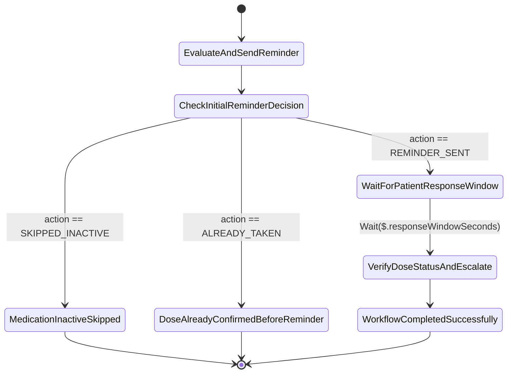

# DoseGuard AI — AWS Serverless Architecture

## 1. Architectural Overview

DoseGuard AI is a 100% serverless medication safety, patient confirmation, and caregiver escalation platform built on AWS. Every component scales to zero when idle and operates without permanent servers, containers, or third-party backend-as-a-service substitutes.

```mermaid
flowchart TB
  subgraph Client["Client Layer"]
    Browser["Patient & Caregiver Web App\n(React + TypeScript + Tailwind + Recharts)"]
  end

  subgraph EdgeAndAuth["Edge Delivery & Identity"]
    CF["Amazon CloudFront\n(HTTPS + Origin Access Control)"]
    S3Frontend["Amazon S3 (Private)\nFrontend Static Assets"]
    Cognito["Amazon Cognito\nUser Pool & JWT Issuer"]
  end

  subgraph ApiAndCompute["API & Serverless Compute"]
    APIGW["Amazon API Gateway HTTP API\n(/api/v1/* + Cognito JWT Authorizer)"]
    LambdaProfile["Lambda: userProfileHandler"]
    LambdaMed["Lambda: medicationHandler"]
    LambdaDose["Lambda: doseHandler"]
    LambdaInvite["Lambda: caregiverInvitationHandler"]
    LambdaAuthz["Lambda: caregiverAuthorizationHandler"]
    LambdaAnalytics["Lambda: analyticsHandler"]
    LambdaNotif["Lambda: notificationHandler"]
    LambdaReport["Lambda: reportHandler"]
  end

  subgraph Orchestration["Closed-Loop Reminder & Escalation Orchestration"]
    Scheduler["Amazon EventBridge Scheduler\n(IANA Timezone Cron + FlexibleTimeWindow OFF)"]
    SFN["AWS Step Functions Standard Workflow\n(DoseGuardAI-ReminderAndEscalationWorkflow)"]
    LambdaRemind["Lambda: reminderWorkflowHandler"]
    LambdaCheck["Lambda: workflowStatusCheckHandler"]
    SNS["Amazon SNS Topic\n(DoseGuardAI-MedicationAlerts)"]
  end

  subgraph Storage["Encrypted Persistence & Private Reports"]
    DDB["Amazon DynamoDB (On-Demand, Encrypted, TTL)\nUsers | Medications | Doses | Caregivers | Invitations | Notifications | Reports | Audit"]
    S3Reports["Amazon S3 (Private, SSE-S3)\nAdherence Reports (Presigned URLs)"]
    CW["Amazon CloudWatch Logs\nStructured JSON Telemetry (7-Day Retention)"]
  end

  Browser -->|HTTPS| CF
  CF -->|OAC SigV4| S3Frontend
  Browser -->|SRP Auth / JWT| Cognito
  Browser -->|Bearer JWT| APIGW
  APIGW -->|Verify Claims| Cognito

  APIGW --> LambdaProfile
  APIGW --> LambdaMed
  APIGW --> LambdaDose
  APIGW --> LambdaInvite
  APIGW --> LambdaAuthz
  APIGW --> LambdaAnalytics
  APIGW --> LambdaNotif
  APIGW --> LambdaReport

  LambdaMed -->|Create/Update/Delete Schedule| Scheduler
  Scheduler -->|Trigger at Scheduled Time| SFN
  LambdaDose -->|On-Demand / Demo Trigger| SFN

  SFN -->|Step 1: Evaluate & Send Reminder| LambdaRemind
  SFN -->|Step 2: Wait Response Window\n(15m Default / 60s Demo)| SFN
  SFN -->|Step 3: Check Dose & Escalate| LambdaCheck

  LambdaRemind --> DDB
  LambdaRemind --> SNS
  LambdaCheck --> DDB
  LambdaCheck --> SNS

  LambdaProfile --> DDB
  LambdaMed --> DDB
  LambdaDose --> DDB
  LambdaInvite --> DDB
  LambdaAuthz --> DDB
  LambdaAnalytics --> DDB
  LambdaNotif --> DDB
  LambdaReport --> DDB
  LambdaReport -->|PutObject & Presigned GetObject| S3Reports
```

---

## 2. Core AWS Service Responsibilities

| AWS Service | Role in DoseGuard AI |
| :--- | :--- |
| **AWS Lambda** | 10 modular Node.js 20 TypeScript handlers compiled with `esbuild`, using AWS SDK v3 and Zod input validation. |
| **Amazon API Gateway (HTTP API)** | Exposes versioned `/api/v1/*` routes protected by a Cognito JWT Authorizer, CORS restrictions, and stage-level burst/rate throttling. |
| **Amazon DynamoDB** | 8 encrypted on-demand (`PAY_PER_REQUEST`) tables with Global Secondary Indexes (`CaregiverPatientsIndex`, `PatientInvitationsIndex`), conditional writes, and TTL expiration. |
| **Amazon S3** | Two strictly private buckets (`BlockPublicAccess.BLOCK_ALL`, `enforceSSL: true`): one for frontend assets served via CloudFront OAC, and one for private adherence reports downloaded via 5-minute presigned URLs. |
| **AWS Step Functions** | Standard Workflow (`DoseGuardAI-ReminderAndEscalationWorkflow`) orchestrating initial dose evaluation, patient reminder dispatch, configurable `Wait` window, post-window DynamoDB verification, and caregiver escalation. |
| **Amazon EventBridge Scheduler** | Provisions a recurring schedule (`dg-med-<id>`) per active medication in the patient's IANA timezone with `FlexibleTimeWindow: OFF`. |
| **Amazon Cognito** | Manages user registration, email verification, password reset, and JWT issuance. Plaintext passwords never touch application code or DynamoDB. |
| **Amazon CloudFront** | Delivers the React SPA over HTTPS with Origin Access Control (OAC) and SPA routing fallbacks (`403`/`404` -> `/index.html`). |
| **Amazon SNS** | Publishes patient medication reminders and caregiver missed-dose escalation alerts with idempotent deduplication. |
| **Amazon CloudWatch** | Captures structured JSON logs from all Lambda functions and Step Functions executions with a 7-day retention policy. |

---

## 3. Step Functions Workflow State Machine



1. **EvaluateAndSendReminder (`reminderWorkflowHandler`)**:
   - Validates `patientId` and `medicationId`.
   - Verifies that the medication exists and `active === true` in `DoseGuard-Medications`.
   - Checks `DoseGuard-Doses` for the composite sort key `${medicationId}#${scheduledDate}#${scheduledTime}`.
   - If `status === 'TAKEN'`, returns `action: 'ALREADY_TAKEN'` and exits cleanly.
   - Otherwise, creates/updates the dose record as `PENDING` (`workflowStatus = 'REMINDER_SENT'`) and dispatches an idempotent patient reminder notification.
2. **WaitForPatientResponseWindow (`sfn.Wait`)**:
   - Waits dynamically for `$.responseWindowSeconds` (900 seconds / 15 minutes in standard operation; 60 seconds in demo mode).
3. **VerifyDoseStatusAndEscalate (`workflowStatusCheckHandler`)**:
   - Re-queries `DoseGuard-Doses` in DynamoDB.
   - If the patient confirmed the dose during the response window (`status === 'TAKEN'`), records `workflowStatus = 'CONFIRMED_IN_TIME'` and prevents caregiver escalation.
   - If still unconfirmed, performs a conditional update (`#status <> :taken`) to mark `status = 'MISSED'` and dispatches idempotent caregiver alerts (`missed#${doseId}#${caregiverId}`) to every active connected caregiver.

